<picture>
  <source media="(prefers-color-scheme: dark)" srcset="./chaos/cluster-dark.svg">
  
</picture>

# Sandeep Komal Pothu

Senior Cloud Operations Engineer. I keep production boring with AWS, Kubernetes, Terraform and DevSecOps.

**This profile is a running system, and you're allowed to break it.** Pick a service, open the issue, and a GitHub Action injects the fault, works out the blast radius and updates the map above. The cluster heals itself. The downtime is real, measured, and counted against a 99.5% SLO.

## Break production

<!-- chaos:start -->

| Service | Role | Status | Break it |
| --- | --- | --- | --- |
| [`profile`](https://github.com/SandeepKomal/SandeepKomal) | ingress | running | [kill](https://github.com/SandeepKomal/SandeepKomal/issues/new?title=chaos%3A%20kill%20profile&body=Press%20%2A%2ASubmit%20new%20issue%2A%2A%20and%20a%20GitHub%20Action%20injects%20this%20fault%20into%20the%20cluster%20on%20the%20profile.%20It%20replies%20with%20the%20blast%20radius%20and%20closes%20the%20issue.%0A%0AThe%20cluster%20heals%20itself.%20Your%20handle%20stays%20in%20the%20incident%20log.) · [latency](https://github.com/SandeepKomal/SandeepKomal/issues/new?title=chaos%3A%20latency%20profile&body=Press%20%2A%2ASubmit%20new%20issue%2A%2A%20and%20a%20GitHub%20Action%20injects%20this%20fault%20into%20the%20cluster%20on%20the%20profile.%20It%20replies%20with%20the%20blast%20radius%20and%20closes%20the%20issue.%0A%0AThe%20cluster%20heals%20itself.%20Your%20handle%20stays%20in%20the%20incident%20log.) · [partition](https://github.com/SandeepKomal/SandeepKomal/issues/new?title=chaos%3A%20partition%20profile&body=Press%20%2A%2ASubmit%20new%20issue%2A%2A%20and%20a%20GitHub%20Action%20injects%20this%20fault%20into%20the%20cluster%20on%20the%20profile.%20It%20replies%20with%20the%20blast%20radius%20and%20closes%20the%20issue.%0A%0AThe%20cluster%20heals%20itself.%20Your%20handle%20stays%20in%20the%20incident%20log.) |
| [`komorapy`](https://github.com/SandeepKomal/KOMORAPY_V4) | app platform | running | [kill](https://github.com/SandeepKomal/SandeepKomal/issues/new?title=chaos%3A%20kill%20komorapy&body=Press%20%2A%2ASubmit%20new%20issue%2A%2A%20and%20a%20GitHub%20Action%20injects%20this%20fault%20into%20the%20cluster%20on%20the%20profile.%20It%20replies%20with%20the%20blast%20radius%20and%20closes%20the%20issue.%0A%0AThe%20cluster%20heals%20itself.%20Your%20handle%20stays%20in%20the%20incident%20log.) · [latency](https://github.com/SandeepKomal/SandeepKomal/issues/new?title=chaos%3A%20latency%20komorapy&body=Press%20%2A%2ASubmit%20new%20issue%2A%2A%20and%20a%20GitHub%20Action%20injects%20this%20fault%20into%20the%20cluster%20on%20the%20profile.%20It%20replies%20with%20the%20blast%20radius%20and%20closes%20the%20issue.%0A%0AThe%20cluster%20heals%20itself.%20Your%20handle%20stays%20in%20the%20incident%20log.) · [partition](https://github.com/SandeepKomal/SandeepKomal/issues/new?title=chaos%3A%20partition%20komorapy&body=Press%20%2A%2ASubmit%20new%20issue%2A%2A%20and%20a%20GitHub%20Action%20injects%20this%20fault%20into%20the%20cluster%20on%20the%20profile.%20It%20replies%20with%20the%20blast%20radius%20and%20closes%20the%20issue.%0A%0AThe%20cluster%20heals%20itself.%20Your%20handle%20stays%20in%20the%20incident%20log.) |
| [`blast-radius`](https://github.com/SandeepKomal/blast-radius) | agent guard | running | [kill](https://github.com/SandeepKomal/SandeepKomal/issues/new?title=chaos%3A%20kill%20blast-radius&body=Press%20%2A%2ASubmit%20new%20issue%2A%2A%20and%20a%20GitHub%20Action%20injects%20this%20fault%20into%20the%20cluster%20on%20the%20profile.%20It%20replies%20with%20the%20blast%20radius%20and%20closes%20the%20issue.%0A%0AThe%20cluster%20heals%20itself.%20Your%20handle%20stays%20in%20the%20incident%20log.) · [latency](https://github.com/SandeepKomal/SandeepKomal/issues/new?title=chaos%3A%20latency%20blast-radius&body=Press%20%2A%2ASubmit%20new%20issue%2A%2A%20and%20a%20GitHub%20Action%20injects%20this%20fault%20into%20the%20cluster%20on%20the%20profile.%20It%20replies%20with%20the%20blast%20radius%20and%20closes%20the%20issue.%0A%0AThe%20cluster%20heals%20itself.%20Your%20handle%20stays%20in%20the%20incident%20log.) · [partition](https://github.com/SandeepKomal/SandeepKomal/issues/new?title=chaos%3A%20partition%20blast-radius&body=Press%20%2A%2ASubmit%20new%20issue%2A%2A%20and%20a%20GitHub%20Action%20injects%20this%20fault%20into%20the%20cluster%20on%20the%20profile.%20It%20replies%20with%20the%20blast%20radius%20and%20closes%20the%20issue.%0A%0AThe%20cluster%20heals%20itself.%20Your%20handle%20stays%20in%20the%20incident%20log.) |
| [`neon-arena`](https://github.com/SandeepKomal/neon-arena) | renderer | running | [kill](https://github.com/SandeepKomal/SandeepKomal/issues/new?title=chaos%3A%20kill%20neon-arena&body=Press%20%2A%2ASubmit%20new%20issue%2A%2A%20and%20a%20GitHub%20Action%20injects%20this%20fault%20into%20the%20cluster%20on%20the%20profile.%20It%20replies%20with%20the%20blast%20radius%20and%20closes%20the%20issue.%0A%0AThe%20cluster%20heals%20itself.%20Your%20handle%20stays%20in%20the%20incident%20log.) · [latency](https://github.com/SandeepKomal/SandeepKomal/issues/new?title=chaos%3A%20latency%20neon-arena&body=Press%20%2A%2ASubmit%20new%20issue%2A%2A%20and%20a%20GitHub%20Action%20injects%20this%20fault%20into%20the%20cluster%20on%20the%20profile.%20It%20replies%20with%20the%20blast%20radius%20and%20closes%20the%20issue.%0A%0AThe%20cluster%20heals%20itself.%20Your%20handle%20stays%20in%20the%20incident%20log.) · [partition](https://github.com/SandeepKomal/SandeepKomal/issues/new?title=chaos%3A%20partition%20neon-arena&body=Press%20%2A%2ASubmit%20new%20issue%2A%2A%20and%20a%20GitHub%20Action%20injects%20this%20fault%20into%20the%20cluster%20on%20the%20profile.%20It%20replies%20with%20the%20blast%20radius%20and%20closes%20the%20issue.%0A%0AThe%20cluster%20heals%20itself.%20Your%20handle%20stays%20in%20the%20incident%20log.) |
| [`devsecops`](https://github.com/SandeepKomal/DevSecOps) | pipeline | running | [kill](https://github.com/SandeepKomal/SandeepKomal/issues/new?title=chaos%3A%20kill%20devsecops&body=Press%20%2A%2ASubmit%20new%20issue%2A%2A%20and%20a%20GitHub%20Action%20injects%20this%20fault%20into%20the%20cluster%20on%20the%20profile.%20It%20replies%20with%20the%20blast%20radius%20and%20closes%20the%20issue.%0A%0AThe%20cluster%20heals%20itself.%20Your%20handle%20stays%20in%20the%20incident%20log.) · [latency](https://github.com/SandeepKomal/SandeepKomal/issues/new?title=chaos%3A%20latency%20devsecops&body=Press%20%2A%2ASubmit%20new%20issue%2A%2A%20and%20a%20GitHub%20Action%20injects%20this%20fault%20into%20the%20cluster%20on%20the%20profile.%20It%20replies%20with%20the%20blast%20radius%20and%20closes%20the%20issue.%0A%0AThe%20cluster%20heals%20itself.%20Your%20handle%20stays%20in%20the%20incident%20log.) · [partition](https://github.com/SandeepKomal/SandeepKomal/issues/new?title=chaos%3A%20partition%20devsecops&body=Press%20%2A%2ASubmit%20new%20issue%2A%2A%20and%20a%20GitHub%20Action%20injects%20this%20fault%20into%20the%20cluster%20on%20the%20profile.%20It%20replies%20with%20the%20blast%20radius%20and%20closes%20the%20issue.%0A%0AThe%20cluster%20heals%20itself.%20Your%20handle%20stays%20in%20the%20incident%20log.) |
| [`paranoid-sre`](https://github.com/SandeepKomal/paranoid-sre) | agent skill | running | [kill](https://github.com/SandeepKomal/SandeepKomal/issues/new?title=chaos%3A%20kill%20paranoid-sre&body=Press%20%2A%2ASubmit%20new%20issue%2A%2A%20and%20a%20GitHub%20Action%20injects%20this%20fault%20into%20the%20cluster%20on%20the%20profile.%20It%20replies%20with%20the%20blast%20radius%20and%20closes%20the%20issue.%0A%0AThe%20cluster%20heals%20itself.%20Your%20handle%20stays%20in%20the%20incident%20log.) · [latency](https://github.com/SandeepKomal/SandeepKomal/issues/new?title=chaos%3A%20latency%20paranoid-sre&body=Press%20%2A%2ASubmit%20new%20issue%2A%2A%20and%20a%20GitHub%20Action%20injects%20this%20fault%20into%20the%20cluster%20on%20the%20profile.%20It%20replies%20with%20the%20blast%20radius%20and%20closes%20the%20issue.%0A%0AThe%20cluster%20heals%20itself.%20Your%20handle%20stays%20in%20the%20incident%20log.) · [partition](https://github.com/SandeepKomal/SandeepKomal/issues/new?title=chaos%3A%20partition%20paranoid-sre&body=Press%20%2A%2ASubmit%20new%20issue%2A%2A%20and%20a%20GitHub%20Action%20injects%20this%20fault%20into%20the%20cluster%20on%20the%20profile.%20It%20replies%20with%20the%20blast%20radius%20and%20closes%20the%20issue.%0A%0AThe%20cluster%20heals%20itself.%20Your%20handle%20stays%20in%20the%20incident%20log.) |
| [`git3d`](https://github.com/SandeepKomal/Git3D-Universe) | renderer | running | [kill](https://github.com/SandeepKomal/SandeepKomal/issues/new?title=chaos%3A%20kill%20git3d&body=Press%20%2A%2ASubmit%20new%20issue%2A%2A%20and%20a%20GitHub%20Action%20injects%20this%20fault%20into%20the%20cluster%20on%20the%20profile.%20It%20replies%20with%20the%20blast%20radius%20and%20closes%20the%20issue.%0A%0AThe%20cluster%20heals%20itself.%20Your%20handle%20stays%20in%20the%20incident%20log.) · [latency](https://github.com/SandeepKomal/SandeepKomal/issues/new?title=chaos%3A%20latency%20git3d&body=Press%20%2A%2ASubmit%20new%20issue%2A%2A%20and%20a%20GitHub%20Action%20injects%20this%20fault%20into%20the%20cluster%20on%20the%20profile.%20It%20replies%20with%20the%20blast%20radius%20and%20closes%20the%20issue.%0A%0AThe%20cluster%20heals%20itself.%20Your%20handle%20stays%20in%20the%20incident%20log.) · [partition](https://github.com/SandeepKomal/SandeepKomal/issues/new?title=chaos%3A%20partition%20git3d&body=Press%20%2A%2ASubmit%20new%20issue%2A%2A%20and%20a%20GitHub%20Action%20injects%20this%20fault%20into%20the%20cluster%20on%20the%20profile.%20It%20replies%20with%20the%20blast%20radius%20and%20closes%20the%20issue.%0A%0AThe%20cluster%20heals%20itself.%20Your%20handle%20stays%20in%20the%20incident%20log.) |
| [`kubernetes`](https://github.com/SandeepKomal/kubernetes-k8s) | control plane | running | [kill](https://github.com/SandeepKomal/SandeepKomal/issues/new?title=chaos%3A%20kill%20kubernetes&body=Press%20%2A%2ASubmit%20new%20issue%2A%2A%20and%20a%20GitHub%20Action%20injects%20this%20fault%20into%20the%20cluster%20on%20the%20profile.%20It%20replies%20with%20the%20blast%20radius%20and%20closes%20the%20issue.%0A%0AThe%20cluster%20heals%20itself.%20Your%20handle%20stays%20in%20the%20incident%20log.) · [latency](https://github.com/SandeepKomal/SandeepKomal/issues/new?title=chaos%3A%20latency%20kubernetes&body=Press%20%2A%2ASubmit%20new%20issue%2A%2A%20and%20a%20GitHub%20Action%20injects%20this%20fault%20into%20the%20cluster%20on%20the%20profile.%20It%20replies%20with%20the%20blast%20radius%20and%20closes%20the%20issue.%0A%0AThe%20cluster%20heals%20itself.%20Your%20handle%20stays%20in%20the%20incident%20log.) · [partition](https://github.com/SandeepKomal/SandeepKomal/issues/new?title=chaos%3A%20partition%20kubernetes&body=Press%20%2A%2ASubmit%20new%20issue%2A%2A%20and%20a%20GitHub%20Action%20injects%20this%20fault%20into%20the%20cluster%20on%20the%20profile.%20It%20replies%20with%20the%20blast%20radius%20and%20closes%20the%20issue.%0A%0AThe%20cluster%20heals%20itself.%20Your%20handle%20stays%20in%20the%20incident%20log.) |

#### Incident log

_No incidents yet. Production has never been this quiet, which is suspicious._

<!-- chaos:end -->

<details>
<summary>How it works</summary>

- Each link opens an issue titled `chaos: <fault> <service>`. Submitting it runs [`chaos.yml`](.github/workflows/chaos.yml).
- [`chaos/engine.py`](chaos/engine.py) checks the title against a strict pattern, records the incident in [`chaos/state.json`](chaos/state.json), and follows the dependency graph to find everything the fault takes with it. Killing `kubernetes-k8s` takes out the whole cluster.
- A reconciler runs every 15 minutes and heals faults once their recovery time has passed: 20 minutes for a killed pod, 30 for latency, 45 for a partition.
- Availability, error budget and mean time to recover come from the incident history, not made-up numbers.
- Guardrails: at most 3 open incidents at once, one fault per service, and one fault per person every 10 minutes.

</details>

## Pending changes

```diff
  # engineer.sandeep will be updated in-place
  ~ resource "engineer" "sandeep" {
        role     = "Senior Cloud Operations Engineer"
  +     focus    = ["AWS", "Kubernetes / EKS", "Terraform", "DevSecOps", "Observability"]
  +     building = "guardrails that stop AI agents from running destructive infra commands"
  -     toil     = "manual deploys, snowflake servers, 3am pages"
  ~     on_call  = "reactive" -> "boring"
    }

  Plan: 2 to add, 1 to change, 1 to destroy.
```

## Service catalog

| Service | What it does |
| --- | --- |
| [blast-radius](https://github.com/SandeepKomal/blast-radius) | A hook for coding agents that previews what an infrastructure command would destroy, then asks or blocks before it runs. |
| [paranoid-sre](https://github.com/SandeepKomal/paranoid-sre) | A skill that makes the agent careful before it ever reaches the hook. |
| [KOMORAPY_V4](https://github.com/SandeepKomal/KOMORAPY_V4) | An application platform from source control through CI/CD, security scanning and Kubernetes to observability. |
| [DevSecOps](https://github.com/SandeepKomal/DevSecOps) | Security in the pipeline: SAST, SCA, container, IaC and Kubernetes checks. |
| [neon-arena](https://github.com/SandeepKomal/neon-arena) | A GitHub Action that renders a year of contributions as an arena. |
| [Git3D-Universe](https://github.com/SandeepKomal/Git3D-Universe) | A GitHub Action that renders contribution history as a universe, switching day and night by local time. |
| [kubernetes-k8s](https://github.com/SandeepKomal/kubernetes-k8s) | Kubernetes configuration and experiments. |

<details>
<summary>Telemetry</summary>





</details>

## Escalation policy

| Severity | Channel |
| --- | --- |
| Sev 3: say hello | [LinkedIn](https://www.linkedin.com/in/sandeep-komal-pothu-ba4497283/) |
| Sev 2: work together | [sandeepkomalp@gmail.com](mailto:sandeepkomalp@gmail.com) |
| Sev 1: production is down | Check the incident log. It was probably you. |

<sub>Independent project, not affiliated with GitHub.</sub>
