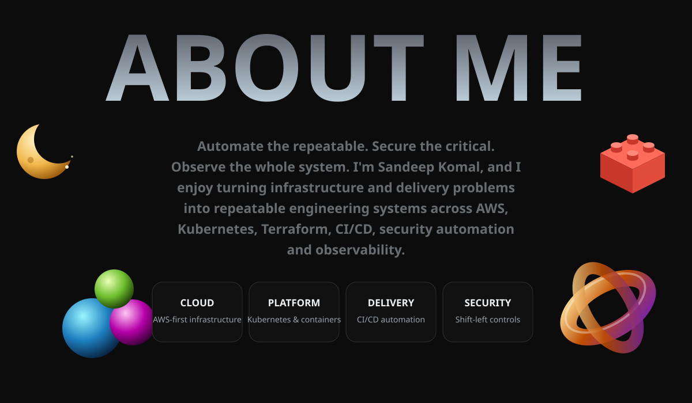
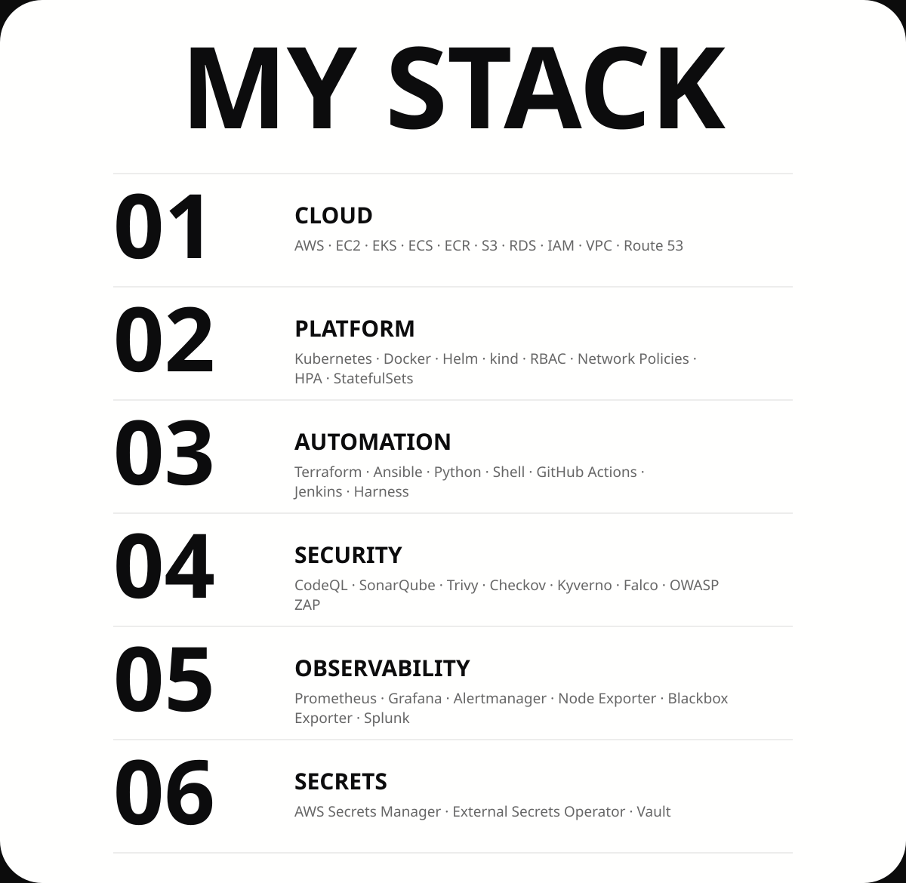
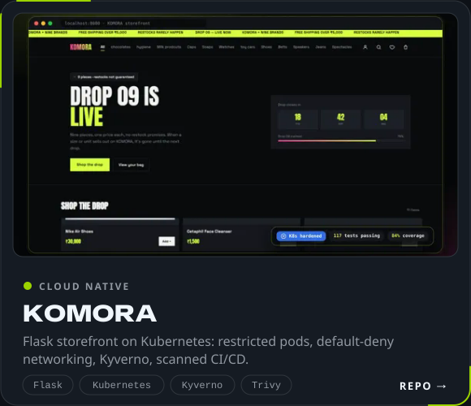
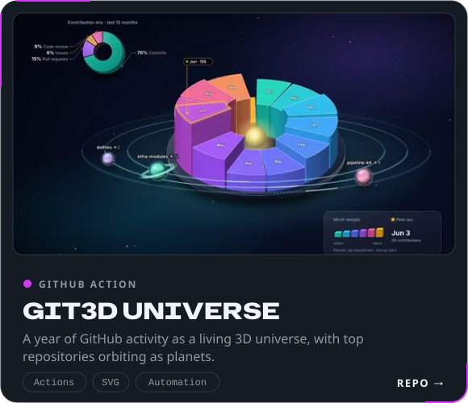
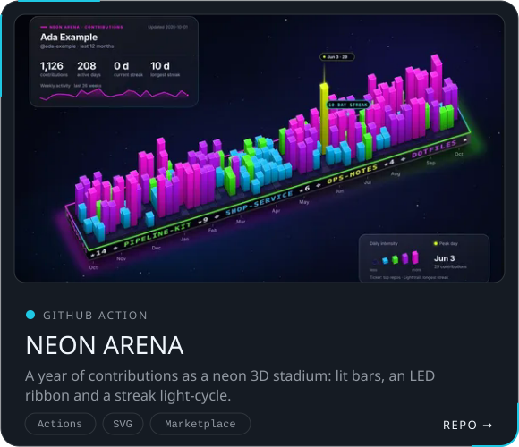
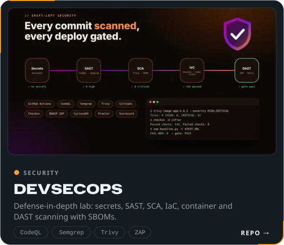
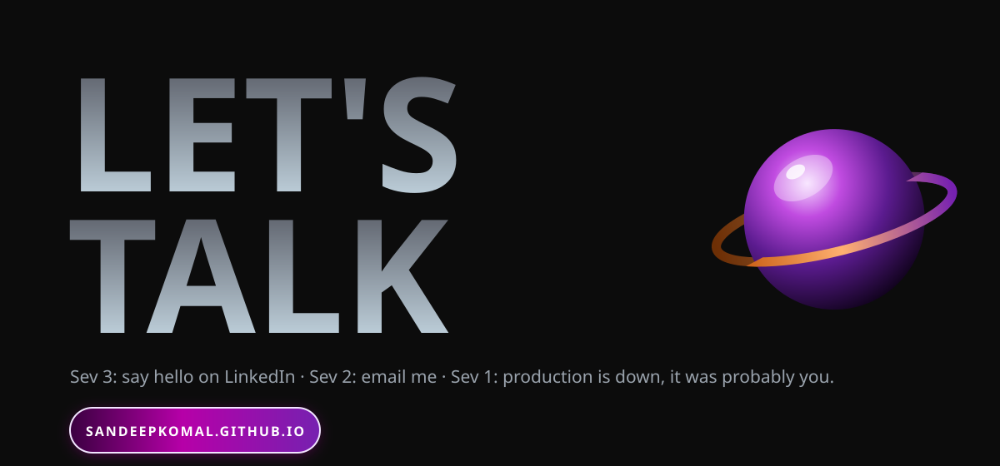

<!-- chaos:start -->

Next target: <code>profile</code>. Edit the issue title to pick another service.

Pick a specific service

| Service | Role | Status | Break it |
| --- | --- | --- | --- |
| [`profile`](https://github.com/SandeepKomal/SandeepKomal) | ingress | running | [kill](https://github.com/SandeepKomal/SandeepKomal/issues/new?title=chaos%3A%20kill%20profile&body=Press%20%2A%2ASubmit%20new%20issue%2A%2A%20and%20a%20GitHub%20Action%20injects%20this%20fault%20into%20the%20cluster%20on%20the%20profile.%20It%20replies%20with%20the%20blast%20radius%20and%20closes%20the%20issue.%0A%0AThe%20cluster%20heals%20itself.%20Your%20handle%20stays%20in%20the%20incident%20log.) · [latency](https://github.com/SandeepKomal/SandeepKomal/issues/new?title=chaos%3A%20latency%20profile&body=Press%20%2A%2ASubmit%20new%20issue%2A%2A%20and%20a%20GitHub%20Action%20injects%20this%20fault%20into%20the%20cluster%20on%20the%20profile.%20It%20replies%20with%20the%20blast%20radius%20and%20closes%20the%20issue.%0A%0AThe%20cluster%20heals%20itself.%20Your%20handle%20stays%20in%20the%20incident%20log.) · [partition](https://github.com/SandeepKomal/SandeepKomal/issues/new?title=chaos%3A%20partition%20profile&body=Press%20%2A%2ASubmit%20new%20issue%2A%2A%20and%20a%20GitHub%20Action%20injects%20this%20fault%20into%20the%20cluster%20on%20the%20profile.%20It%20replies%20with%20the%20blast%20radius%20and%20closes%20the%20issue.%0A%0AThe%20cluster%20heals%20itself.%20Your%20handle%20stays%20in%20the%20incident%20log.) |
| [`komorapy`](https://github.com/SandeepKomal/KOMORAPY_V4) | app platform | running | [kill](https://github.com/SandeepKomal/SandeepKomal/issues/new?title=chaos%3A%20kill%20komorapy&body=Press%20%2A%2ASubmit%20new%20issue%2A%2A%20and%20a%20GitHub%20Action%20injects%20this%20fault%20into%20the%20cluster%20on%20the%20profile.%20It%20replies%20with%20the%20blast%20radius%20and%20closes%20the%20issue.%0A%0AThe%20cluster%20heals%20itself.%20Your%20handle%20stays%20in%20the%20incident%20log.) · [latency](https://github.com/SandeepKomal/SandeepKomal/issues/new?title=chaos%3A%20latency%20komorapy&body=Press%20%2A%2ASubmit%20new%20issue%2A%2A%20and%20a%20GitHub%20Action%20injects%20this%20fault%20into%20the%20cluster%20on%20the%20profile.%20It%20replies%20with%20the%20blast%20radius%20and%20closes%20the%20issue.%0A%0AThe%20cluster%20heals%20itself.%20Your%20handle%20stays%20in%20the%20incident%20log.) · [partition](https://github.com/SandeepKomal/SandeepKomal/issues/new?title=chaos%3A%20partition%20komorapy&body=Press%20%2A%2ASubmit%20new%20issue%2A%2A%20and%20a%20GitHub%20Action%20injects%20this%20fault%20into%20the%20cluster%20on%20the%20profile.%20It%20replies%20with%20the%20blast%20radius%20and%20closes%20the%20issue.%0A%0AThe%20cluster%20heals%20itself.%20Your%20handle%20stays%20in%20the%20incident%20log.) |
| [`blast-radius`](https://github.com/SandeepKomal/blast-radius) | agent guard | running | [kill](https://github.com/SandeepKomal/SandeepKomal/issues/new?title=chaos%3A%20kill%20blast-radius&body=Press%20%2A%2ASubmit%20new%20issue%2A%2A%20and%20a%20GitHub%20Action%20injects%20this%20fault%20into%20the%20cluster%20on%20the%20profile.%20It%20replies%20with%20the%20blast%20radius%20and%20closes%20the%20issue.%0A%0AThe%20cluster%20heals%20itself.%20Your%20handle%20stays%20in%20the%20incident%20log.) · [latency](https://github.com/SandeepKomal/SandeepKomal/issues/new?title=chaos%3A%20latency%20blast-radius&body=Press%20%2A%2ASubmit%20new%20issue%2A%2A%20and%20a%20GitHub%20Action%20injects%20this%20fault%20into%20the%20cluster%20on%20the%20profile.%20It%20replies%20with%20the%20blast%20radius%20and%20closes%20the%20issue.%0A%0AThe%20cluster%20heals%20itself.%20Your%20handle%20stays%20in%20the%20incident%20log.) · [partition](https://github.com/SandeepKomal/SandeepKomal/issues/new?title=chaos%3A%20partition%20blast-radius&body=Press%20%2A%2ASubmit%20new%20issue%2A%2A%20and%20a%20GitHub%20Action%20injects%20this%20fault%20into%20the%20cluster%20on%20the%20profile.%20It%20replies%20with%20the%20blast%20radius%20and%20closes%20the%20issue.%0A%0AThe%20cluster%20heals%20itself.%20Your%20handle%20stays%20in%20the%20incident%20log.) |
| [`neon-arena`](https://github.com/SandeepKomal/neon-arena) | renderer | running | [kill](https://github.com/SandeepKomal/SandeepKomal/issues/new?title=chaos%3A%20kill%20neon-arena&body=Press%20%2A%2ASubmit%20new%20issue%2A%2A%20and%20a%20GitHub%20Action%20injects%20this%20fault%20into%20the%20cluster%20on%20the%20profile.%20It%20replies%20with%20the%20blast%20radius%20and%20closes%20the%20issue.%0A%0AThe%20cluster%20heals%20itself.%20Your%20handle%20stays%20in%20the%20incident%20log.) · [latency](https://github.com/SandeepKomal/SandeepKomal/issues/new?title=chaos%3A%20latency%20neon-arena&body=Press%20%2A%2ASubmit%20new%20issue%2A%2A%20and%20a%20GitHub%20Action%20injects%20this%20fault%20into%20the%20cluster%20on%20the%20profile.%20It%20replies%20with%20the%20blast%20radius%20and%20closes%20the%20issue.%0A%0AThe%20cluster%20heals%20itself.%20Your%20handle%20stays%20in%20the%20incident%20log.) · [partition](https://github.com/SandeepKomal/SandeepKomal/issues/new?title=chaos%3A%20partition%20neon-arena&body=Press%20%2A%2ASubmit%20new%20issue%2A%2A%20and%20a%20GitHub%20Action%20injects%20this%20fault%20into%20the%20cluster%20on%20the%20profile.%20It%20replies%20with%20the%20blast%20radius%20and%20closes%20the%20issue.%0A%0AThe%20cluster%20heals%20itself.%20Your%20handle%20stays%20in%20the%20incident%20log.) |
| [`devsecops`](https://github.com/SandeepKomal/DevSecOps) | pipeline | running | [kill](https://github.com/SandeepKomal/SandeepKomal/issues/new?title=chaos%3A%20kill%20devsecops&body=Press%20%2A%2ASubmit%20new%20issue%2A%2A%20and%20a%20GitHub%20Action%20injects%20this%20fault%20into%20the%20cluster%20on%20the%20profile.%20It%20replies%20with%20the%20blast%20radius%20and%20closes%20the%20issue.%0A%0AThe%20cluster%20heals%20itself.%20Your%20handle%20stays%20in%20the%20incident%20log.) · [latency](https://github.com/SandeepKomal/SandeepKomal/issues/new?title=chaos%3A%20latency%20devsecops&body=Press%20%2A%2ASubmit%20new%20issue%2A%2A%20and%20a%20GitHub%20Action%20injects%20this%20fault%20into%20the%20cluster%20on%20the%20profile.%20It%20replies%20with%20the%20blast%20radius%20and%20closes%20the%20issue.%0A%0AThe%20cluster%20heals%20itself.%20Your%20handle%20stays%20in%20the%20incident%20log.) · [partition](https://github.com/SandeepKomal/SandeepKomal/issues/new?title=chaos%3A%20partition%20devsecops&body=Press%20%2A%2ASubmit%20new%20issue%2A%2A%20and%20a%20GitHub%20Action%20injects%20this%20fault%20into%20the%20cluster%20on%20the%20profile.%20It%20replies%20with%20the%20blast%20radius%20and%20closes%20the%20issue.%0A%0AThe%20cluster%20heals%20itself.%20Your%20handle%20stays%20in%20the%20incident%20log.) |
| [`paranoid-sre`](https://github.com/SandeepKomal/paranoid-sre) | agent skill | running | [kill](https://github.com/SandeepKomal/SandeepKomal/issues/new?title=chaos%3A%20kill%20paranoid-sre&body=Press%20%2A%2ASubmit%20new%20issue%2A%2A%20and%20a%20GitHub%20Action%20injects%20this%20fault%20into%20the%20cluster%20on%20the%20profile.%20It%20replies%20with%20the%20blast%20radius%20and%20closes%20the%20issue.%0A%0AThe%20cluster%20heals%20itself.%20Your%20handle%20stays%20in%20the%20incident%20log.) · [latency](https://github.com/SandeepKomal/SandeepKomal/issues/new?title=chaos%3A%20latency%20paranoid-sre&body=Press%20%2A%2ASubmit%20new%20issue%2A%2A%20and%20a%20GitHub%20Action%20injects%20this%20fault%20into%20the%20cluster%20on%20the%20profile.%20It%20replies%20with%20the%20blast%20radius%20and%20closes%20the%20issue.%0A%0AThe%20cluster%20heals%20itself.%20Your%20handle%20stays%20in%20the%20incident%20log.) · [partition](https://github.com/SandeepKomal/SandeepKomal/issues/new?title=chaos%3A%20partition%20paranoid-sre&body=Press%20%2A%2ASubmit%20new%20issue%2A%2A%20and%20a%20GitHub%20Action%20injects%20this%20fault%20into%20the%20cluster%20on%20the%20profile.%20It%20replies%20with%20the%20blast%20radius%20and%20closes%20the%20issue.%0A%0AThe%20cluster%20heals%20itself.%20Your%20handle%20stays%20in%20the%20incident%20log.) |
| [`git3d`](https://github.com/SandeepKomal/Git3D-Universe) | renderer | running | [kill](https://github.com/SandeepKomal/SandeepKomal/issues/new?title=chaos%3A%20kill%20git3d&body=Press%20%2A%2ASubmit%20new%20issue%2A%2A%20and%20a%20GitHub%20Action%20injects%20this%20fault%20into%20the%20cluster%20on%20the%20profile.%20It%20replies%20with%20the%20blast%20radius%20and%20closes%20the%20issue.%0A%0AThe%20cluster%20heals%20itself.%20Your%20handle%20stays%20in%20the%20incident%20log.) · [latency](https://github.com/SandeepKomal/SandeepKomal/issues/new?title=chaos%3A%20latency%20git3d&body=Press%20%2A%2ASubmit%20new%20issue%2A%2A%20and%20a%20GitHub%20Action%20injects%20this%20fault%20into%20the%20cluster%20on%20the%20profile.%20It%20replies%20with%20the%20blast%20radius%20and%20closes%20the%20issue.%0A%0AThe%20cluster%20heals%20itself.%20Your%20handle%20stays%20in%20the%20incident%20log.) · [partition](https://github.com/SandeepKomal/SandeepKomal/issues/new?title=chaos%3A%20partition%20git3d&body=Press%20%2A%2ASubmit%20new%20issue%2A%2A%20and%20a%20GitHub%20Action%20injects%20this%20fault%20into%20the%20cluster%20on%20the%20profile.%20It%20replies%20with%20the%20blast%20radius%20and%20closes%20the%20issue.%0A%0AThe%20cluster%20heals%20itself.%20Your%20handle%20stays%20in%20the%20incident%20log.) |
| [`kubernetes`](https://github.com/SandeepKomal/kubernetes-k8s) | control plane | running | [kill](https://github.com/SandeepKomal/SandeepKomal/issues/new?title=chaos%3A%20kill%20kubernetes&body=Press%20%2A%2ASubmit%20new%20issue%2A%2A%20and%20a%20GitHub%20Action%20injects%20this%20fault%20into%20the%20cluster%20on%20the%20profile.%20It%20replies%20with%20the%20blast%20radius%20and%20closes%20the%20issue.%0A%0AThe%20cluster%20heals%20itself.%20Your%20handle%20stays%20in%20the%20incident%20log.) · [latency](https://github.com/SandeepKomal/SandeepKomal/issues/new?title=chaos%3A%20latency%20kubernetes&body=Press%20%2A%2ASubmit%20new%20issue%2A%2A%20and%20a%20GitHub%20Action%20injects%20this%20fault%20into%20the%20cluster%20on%20the%20profile.%20It%20replies%20with%20the%20blast%20radius%20and%20closes%20the%20issue.%0A%0AThe%20cluster%20heals%20itself.%20Your%20handle%20stays%20in%20the%20incident%20log.) · [partition](https://github.com/SandeepKomal/SandeepKomal/issues/new?title=chaos%3A%20partition%20kubernetes&body=Press%20%2A%2ASubmit%20new%20issue%2A%2A%20and%20a%20GitHub%20Action%20injects%20this%20fault%20into%20the%20cluster%20on%20the%20profile.%20It%20replies%20with%20the%20blast%20radius%20and%20closes%20the%20issue.%0A%0AThe%20cluster%20heals%20itself.%20Your%20handle%20stays%20in%20the%20incident%20log.) |

Recent breaks

_Nobody has broken it yet._

<!-- chaos:end -->

How it works

- Each button opens an issue titled `chaos: <fault> <service>`. Submitting it runs [`chaos.yml`](.github/workflows/chaos.yml).
- [`chaos/engine.py`](chaos/engine.py) checks the title against a strict pattern, records the break in [`chaos/state.json`](chaos/state.json), and follows the dependency graph to find everything it takes down. Killing `kubernetes-k8s` takes out the whole system.
- A reconciler runs every 15 minutes and heals faults once their recovery time has passed: 20 minutes for a killed pod, 30 for latency, 45 for a cut network.
- Uptime, times broken and average fix time come from the recorded breaks.
- Guardrails: at most 3 open breaks at once, one per service, and one per person every 10 minutes.

<a href="https://www.linkedin.com/in/sandeep-komal-pothu-ba4497283">LinkedIn</a> ·
<a href="mailto:sandeepkomalp@gmail.com">Email</a> ·
<a href="https://sandeepkomalp.medium.com">Medium</a> ·
<a href="https://sandeepkomal.github.io/">Website</a>

Independent project, not affiliated with GitHub.

